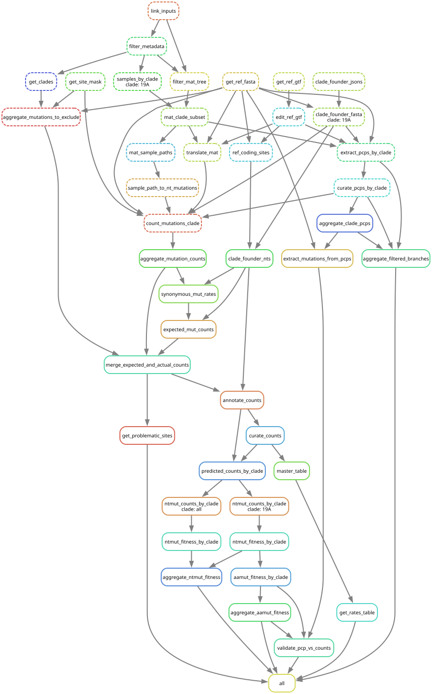

# mat-pcp: Unified MAT Analysis Pipeline

A Snakemake pipeline for analyzing SARS-CoV-2 genomic evolution from mutation-annotated trees (MATs). This pipeline extracts parent-child pairs (PCPs), counts mutations, estimates neutral mutation rates, and calculates fitness effects.

## Overview

This pipeline combines functionality from three previously separate projects:
1. **mat-pcp** - Parent-child pair extraction from MATs
2. **SARS2-mut-fitness** - Expected vs actual mutation count computation
3. **SARS2-mut-fitness-v2** - Neutral mutation rate estimation via GLM

## Versioning

The pipeline uses simple integer versioning (v1, v2, v3, etc.) to enable reproducibility tracking. The version is automatically appended to output directories to clearly identify which pipeline version produced the outputs.

- **Current Version**: v1 (see [CHANGELOG.md](CHANGELOG.md) for version history)
- **Version File**: The pipeline version is stored in the `VERSION` file at the repository root
- **Output Naming**: Outputs are automatically versioned (e.g., `results/public_2022-06-01_v1`)
- **Git Tags**: Each version is tagged in git for easy reference (e.g., `git checkout v1`)

### Why Versioning?

Any change to output format or filtering logic that affects downstream consumers bumps the version. This is critical because:
- Models trained on one version's outputs may not work with another's
- Downstream manifests can specify exact pipeline versions
- Output schema changes are tracked in [CHANGELOG.md](CHANGELOG.md)

### Referencing a Specific Version

To use a specific pipeline version:
```bash
git checkout v1  # or v2, v3, etc.
pixi install
pixi run snakemake -j 4 --use-conda
```

## Pipeline DAG

The following diagram shows the workflow structure when running with test data (`max_clades=1`):



## Quick Start

### Prerequisites

- [pixi](https://pixi.sh/) for environment management
- Input MAT tree (`.pb` or `.pb.gz` format)
- Sample metadata (`.tsv` or `.tsv.gz` format)

### Installation

```bash
git clone <repository-url>
cd mat-pcp
pixi install
```

### Configuration

Edit `config/config.yaml` to specify your inputs:

```yaml
mat: "path/to/your/tree.pb.gz"
metadata: "path/to/your/metadata.tsv.gz"
output_dir: "results"
```

### Running the Pipeline

```bash
# Dry run to see what will be executed
pixi run snakemake -n

# Run with 4 cores
pixi run snakemake -j 4 --use-conda

# Run specific target
pixi run snakemake -j 4 --use-conda results/aamut_fitness/all_aamut_fitness.csv
```

## Pipeline Stages

| Stage | Description | Key Outputs |
|-------|-------------|-------------|
| 1. Input & Reference | Filter metadata, link inputs, fetch reference genome and annotations | `filtered_metadata.tsv.gz`, `ref.fa`, `coding_sites.csv` |
| 2. Clade Processing & PCPs | Identify clades, extract clade subtrees, and emit curated PCPs in one pass (identical-slice branches are dropped during extraction). DASM-training-ready siblings are emitted alongside. | `clade_counts.csv`, `clades/{clade}_tree.pb`, `pcps/{clade}_pcps.csv`, `pcps/all_pcps.csv`, `pcps/{clade}_pcps_dasm_ready.csv`, `pcps/all_pcps_dasm_ready.csv`, `pcp_curation_report.txt` |
| 3a. Clade Founders | Download and process clade founder sequences (whole-genome + gene-sliced, e.g. Spike) | `clade_founders/{clade}.fa`, `clade_founders/spike/{clade}.fa`, `clade_founder_nts.csv` |
| 3b. Mutation Counting | Translate mutations, count per-clade mutations (harmonized with PCP filtering) | `mutations/{clade}_mutations.tsv`, `mutation_counts/aggregated.csv` |
| 4. Expected Counts | Compute synonymous rates and expected mutation counts | `synonymous_mut_rates/`, `expected_vs_actual_mut_counts.csv` |
| 5. GLM Annotation | Annotate counts with RNA structure and sequence context | `glm/annotated_counts.csv`, `glm/curated_counts.csv` |
| 6. Rate Estimation | Estimate neutral mutation rates via GLM | `glm/master_table.csv`, `rates_table.csv` |
| 7a. NT Fitness | Compute nucleotide-level fitness estimates | `fitness/ntmut_fitness_aggregated.csv` |
| 7b. AA Fitness | Compute amino acid-level fitness estimates | `aamut_fitness/all_aamut_fitness.csv` |
| 8. Validation | Cross-validate PCP vs matUtils mutation counts | `validation/pcp_vs_counts_report.txt` |

## Primary Outputs

> **Using the outputs?** See [OUTPUT_SCHEMA.md](OUTPUT_SCHEMA.md) for detailed column definitions and data types.

| Output | Description |
|--------|-------------|
| `pcps/all_pcps.csv` | All curated parent-child pairs with clade annotations |
| `pcps/all_pcps_dasm_ready.csv` | DASM-training-ready PCPs (filters + 90/10 `in_train` split applied); per-clade siblings at `pcps/{clade}_pcps_dasm_ready.csv` |
| `pcps/pcp_curation_report.txt` | Report showing PCP filtering statistics |
| `pcps/filtered_branch_ids.csv` | Branch IDs excluded from mutation counting |
| `mat/clade_counts.csv` | Sample counts per clade |
| `clade_founder_nts.csv` | Nucleotide at each coding site for all clade founders |
| `mutation_counts/aggregated.csv` | Aggregated mutation counts across all clades |
| `expected_vs_actual_mut_counts.csv` | Expected and actual mutation counts |
| `glm/annotated_counts.csv` | Mutation counts annotated with RNA structure and context |
| `glm/curated_counts.csv` | Curated counts for GLM training |
| `glm/master_table.csv` | Full GLM rate table with light-switch boundaries |
| `rates_table.csv` | Neutral mutation rates by context |
| `spike_codon_sites_to_mask.txt` | Problematic codon sites in target gene |
| `fitness/predicted_counts_by_clade.csv` | GLM-predicted counts per clade |
| `fitness/ntmut_fitness_aggregated.csv` | Nucleotide-level fitness estimates |
| `aamut_fitness/all_aamut_fitness.csv` | Amino acid-level fitness estimates |
| `validation/pcp_vs_counts_report.txt` | PCP vs counts validation report |

## Fitness Estimation Methodology

"Fitness" in this pipeline measures how often a mutation is **observed** relative to a **neutral baseline** of how often it would be expected by chance. A positive value means the mutation appears more often than the baseline predicts (potentially beneficial); a negative value means it appears less often (potentially deleterious). The pipeline emits several distinct fitness values across three output files, summarized below. Column definitions live in [`OUTPUT_SCHEMA.md`](OUTPUT_SCHEMA.md); the parameters that control these computations are in the [Fitness Estimation](#fitness-estimation) configuration table.

### The fitness values

| Value | File | Baseline | Method |
|-------|------|----------|--------|
| `f_max`, `f_mean`, `f_st_dev`, `left_conf_int`, `right_conf_int` | `fitness/ntmut_fitness_aggregated.csv` | `predicted_count` (GLM) | Per-nucleotide **Bayesian Poisson** posterior over the fitness effect `f` |
| `delta_fitness`, `uncertainty` | `aamut_fitness/all_aamut_fitness.csv` | inherited from the nucleotide estimates | **Inverse-variance weighted average** of the nucleotide `f_mean` values over codon-equivalent mutations |
| `naive_delta_fitness` | `aamut_fitness/all_aamut_fitness.csv` | `expected_count` (synonymous rates) | Smoothed log-ratio: `log((actual_count + 0.5) / (expected_count + 0.5))` |

### Nucleotide-level Bayesian fitness

For each nucleotide mutation, the observed count is modeled with a Bayesian Poisson model in which the count has rate `predicted_count · exp(f)`, where `f` is the fitness effect. The model also accounts for uncertainty in the expected count via the GLM variance component `tau_squared`. From the resulting posterior over `f`, the pipeline reports the maximum a posteriori estimate (`f_max`), the posterior mean and standard deviation (`f_mean`, `f_st_dev`), and a 68% credible interval (`left_conf_int`, `right_conf_int`). The grid resolution of the posterior integration is set by the config parameters `fitness_N_f` and `fitness_N_n_exp` (both default 300). This logic lives in `workflow/modules/probfit.py`.

### From nucleotide to amino-acid fitness

The amino-acid `delta_fitness` is an **inverse-variance weighted average** of the nucleotide-level `f_mean` estimates across every codon change that produces the same amino-acid substitution (`workflow/modules/aamutfit.py`, `aa_fitness`):

- per-nucleotide weight: `weight = 1 / (f_st_dev² + 0.001)` (the `0.001` is a numerical-stability constant)
- `delta_fitness = Σ(f_mean · weight) / Σ(weight)`
- `uncertainty = sqrt(1 / Σ(weight))`

Cross-clade aggregation into `all_aamut_fitness.csv` (`workflow/scripts/aggregate_aamut_fitness.py`) sums the counts and re-applies the same inverse-variance weighting across the contributing clades.

### A note on baselines: expected vs. predicted counts

Two different neutral baselines appear in the outputs:

- `expected_count` — derived from **synonymous mutation rates** only.
- `predicted_count` — derived from the **GLM**, additionally incorporating sequence context and RNA structure.

The pipeline's `naive_delta_fitness` is a raw log-ratio against `expected_count`, whereas the primary `delta_fitness` is the Bayesian estimate built on `predicted_count` (via the Poisson rate and `tau_squared`) — it is **not** a raw log-ratio of either count.

### Contrast: how a downstream consumer recomputes fitness

A downstream consumer — the `viral_fitness` dashboard in the separate `dasm2-experiments` repository (`dasm2/analysis/viral.py`) — does **not** use the pipeline's `delta_fitness` column. Instead it recomputes its own fitness directly from the pipeline's `actual_count` and `predicted_count` columns:

- per-mutation (`computed_delta_fitness_pseudo`): `log((actual_count + pc) / (predicted_count + pc))`, with the dashboard's default pseudocount `pc = 0.5`.
- per-site (`sitewise_delta_fitness`): the same ratio computed over counts **summed across all mutations at a site**.

The dashboard then correlates these recomputed values against a neural model's amino-acid selection factors (the cross-clade shift and directional-concordance analysis is outside the scope of this pipeline's outputs).

The two definitions differ as follows:

| | Pipeline `delta_fitness` | Dashboard `computed_delta_fitness_pseudo` |
|---|---|---|
| Form | Bayesian hierarchical posterior | Direct smoothed log-ratio |
| Baseline | `predicted_count` (GLM) | `predicted_count` (GLM) |
| Uncertainty | reported (`uncertainty`) | none (point estimate) |
| Pseudocount | n/a (model-based) | `+0.5` in numerator and denominator |
| Where computed | inside this pipeline | recomputed by the consumer from pipeline counts |

Both rest on the GLM `predicted_count`, but one is a hierarchical Bayesian posterior with quantified uncertainty and the other is a plain pseudocount-smoothed log-ratio.

## PCP vs matUtils Mutation Count Validation

The pipeline includes a validation step (`validate_pcp_vs_counts`) that cross-checks amino acid mutation counts derived from two independent methods:

1. **PCP Method:** Parent-child pairs extracted from the tree, then translated to amino acids
2. **matUtils Method:** matUtils mutations counted and filtered, then aggregated to amino acids

This validation provides crucial quality assurance by ensuring both methods see the same mutations. However, certain **expected differences** arise from legitimate methodological differences:

### Expected Differences

#### 1. Reversions to Clade Founder (matUtils excludes, PCP includes)

**Cause:** The matUtils fitness pipeline generates expected mutation counts only for forward mutations FROM the clade founder. When merging actual counts with expected counts (LEFT JOIN), reversions TO the founder are dropped even though they passed quality filters.

**Example:** In clade 19A, mutations like G614D (reversion to founder D) appear in PCP counts but not in matUtils aamut_fitness.

**Why this is acceptable:** The fitness estimation pipeline is designed to analyze forward mutations from the founder. Reversions are scientifically interesting but handled separately in downstream analyses.

**Affected mutations:** Typically 5-10 reversions per clade (e.g., G614D, R452L, Y80D, V222A in 19A)

#### 2. Terminal vs Non-Terminal Splits (matUtils counts higher)

**Cause:** The matUtils pipeline splits nucleotide mutations by terminal vs non-terminal branch status, then sums these when aggregating to amino acid level. The PCP method counts unique codon-level changes without this distinction.

**Example:** Mutation A623V appears once in raw data but matUtils splits it into terminal and non-terminal counts, summing to 2 at the AA level.

**Why this is acceptable:** The terminal/non-terminal distinction is useful for certain fitness analyses. The difference is typically ±1 for a small number of mutations.

**Affected mutations:** Typically 1-3 mutations per clade with terminal/non-terminal heterogeneity

#### 3. Synonymous Reversions (PCP counts higher)

**Cause:** For synonymous mutations that can occur bidirectionally (e.g., ACC↔ACT for T1116T), the PCP method counts both directions while matUtils filters reversions to the founder.

**Example:** T1116T can occur as C24910T (reversion) or T24910C (forward). PCP counts both (6 total), matUtils counts only forward (3 total).

**Why this is acceptable:** Same rationale as #1 - reversions are filtered from the fitness pipeline by design.

**Affected mutations:** Typically 2-5 synonymous mutations per clade

### Validation Success Criteria

The validation passes if:
- All **unexpected** discrepancies are resolved (bugs, implementation errors)
- **Expected** discrepancies match the patterns above
- No new mutation types appear exclusively in one method

The validation report (`pcp_vs_counts_report.txt`) notes which discrepancies are expected vs unexpected.

## Configuration Options

See `config/config.yaml` for all configuration options. Key parameters are organized into sections:

### Input/Output

| Parameter | Description | Default |
|-----------|-------------|---------|
| `output_dir` | Output directory | `results` |
| `mat` | Path to input MAT tree (.pb or .pb.gz) | - |
| `metadata` | Path to sample metadata (.tsv or .tsv.gz) | - |

### Reference Genome

| Parameter | Description | Default |
|-----------|-------------|---------|
| `ref_fasta` | URL or path to reference FASTA | UCSC wuhCor1 |
| `ref_gtf` | URL or path to reference GTF | UCSC ncbiGenes |
| `add_to_ref_gtf` | Manual GTF additions (e.g., ORF9b) | `{ORF9b: [28284, 28577]}` |

### QC Filtering

| Parameter | Description | Default |
|-----------|-------------|---------|
| `qc_filter_options.min_date` | Earliest sample date | `2019-12-01` |
| `qc_filter_options.datetime_cutoff` | Latest sample date | `2022-06-01` |
| `qc_filter_options.valid_hosts` | Allowed host species | `["Human", "Homo sapiens"]` |
| `qc_filter_options.min_genome_length` | Minimum genome length | `28000` |
| `subset_frac` | Random sampling fraction (1.0 = no sampling) | `1.0` |

### Clade Configuration

| Parameter | Description | Default |
|-----------|-------------|---------|
| `clade_column` | Metadata column for clades | `Nextstrain_clade` |
| `min_clade_size` | Minimum samples per clade | `2` |
| `clades_to_exclude` | List of clades to skip | `[]` |
| `max_clades` | Limit number of clades (for testing) | `null` |

### PCP Extraction

| Parameter | Description | Default |
|-----------|-------------|---------|
| `pcp_gene_region` | Genomic region for PCPs (null = full genome). Coordinates are **1-based inclusive** on both ends, relative to Wuhan-Hu-1 (NC_045512.2); for Spike the end excludes the trailing stop codon. Also drives the gene-sliced founder FASTA output. | Spike (21563-25381) |
| `pcp_max_nt_mutations` | Max nucleotide mutations per branch | `4` |
| `pcp_max_reversions_to_ref` | Max reversions to reference | `1` |
| `pcp_max_reversions_to_clade_founder` | Max reversions to clade founder | `1` |

### Mutation Counting

| Parameter | Description | Default |
|-----------|-------------|---------|
| `max_nt_mutations` | Maximum mutations per branch | `4` |
| `max_reversions_to_ref` | Max reversions to reference | `1` |
| `max_reversions_to_clade_founder` | Max reversions to clade founder | `1` |
| `exclude_ref_to_founder_muts` | Exclude ref→founder mutations | `true` |
| `site_include_range` | Genomic range for mutation counting | `{start: 266, end: 29674}` |
| `sites_to_exclude` | List of problematic sites | See config |

### GLM Rate Estimation

| Parameter | Description | Default |
|-----------|-------------|---------|
| `rna_structure_data` | Path to RNA structure data | `data/lan_2022/...` |
| `glm_lightswitch_boundaries` | Position-dependent rate boundaries | See config |

### Fitness Estimation

| Parameter | Description | Default |
|-----------|-------------|---------|
| `fitness_pseudocount` | Pseudocount for fitness calculation | `0.5` |
| `fitness_N_f` | Number of fitness grid points | `300` |
| `fitness_N_n_exp` | Number of expected counts grid points | `300` |

### Data Files

The pipeline uses reference data files in `data/`:
- `usher_masked_sites.yaml`: UShER masking information for problematic sites by clade
- `lan_2022/`: RNA secondary structure data from Lan et al. 2022

## Branch Filtering

The pipeline applies multiple layers of filtering to ensure high-quality data for downstream analysis. Understanding these filters is important for interpreting results.

### Filter Summary

| Stage | Filter | Purpose | Applied To |
|-------|--------|---------|------------|
| Metadata QC | Date range | Exclude samples outside study period | All samples |
| Metadata QC | Host species | Limit to human samples | All samples |
| Metadata QC | Genome length | Exclude incomplete genomes | All samples |
| Clade Selection | Minimum size | Ensure statistical power | Clades |
| Clade Selection | Exclusion list | Skip problematic clades | Clades |
| PCP Extraction | Max mutations | Exclude hypermutated branches | Branches |
| PCP Extraction | Max reversions | Exclude branches with many reversions | Branches |
| PCP Curation | Identical sequences | Remove zero-mutation PCPs | PCPs |
| PCP Curation | Stop codons | Remove PCPs with premature stops | PCPs |
| PCP Curation | Ambiguous codons | Mask codons with N bases | PCPs |
| Mutation Counting | Filtered branches | Harmonize with PCP curation | Branches |
| Mutation Counting | Site masking | Exclude problematic genomic sites | Mutations |

### PCP Extraction Filters

During initial PCP extraction (`extract_pcps_by_clade`), branches are filtered based on:

1. **Maximum nucleotide mutations** (`pcp_max_nt_mutations`): Branches with more than this many mutations are excluded (default: 4)
2. **Maximum reversions to reference** (`pcp_max_reversions_to_ref`): Branches reverting too many sites to the reference are excluded (default: 1)
3. **Maximum reversions to clade founder** (`pcp_max_reversions_to_clade_founder`): Branches reverting too many sites to the clade founder are excluded (default: 1)

### PCP Curation Filter

`extract_pcps_by_clade` removes parent/child pairs whose sliced sequences are identical in the same pass that builds them:

1. **Identical sequences**: Parent and child sequences that are identical (in the gene region) are dropped before the per-clade `pcps/{clade}_pcps.csv` is written.

The IDs of dropped branches are written to `pcps/{clade}_filtered_branches.csv` and consumed downstream by mutation counting (see "Harmonized Mutation Counting" below).

Note: Stop codons and ambiguous bases outside the gene region of interest do not cause PCPs to be filtered, as sequences are already sliced to the gene region during extraction. This ensures that sequence properties outside the gene region don't create artificial discrepancies in validation.

### Harmonized Mutation Counting

To ensure consistency between PCP-derived and matUtils-derived mutation counts, the mutation counting step (`count_mutations_clade`) excludes branches that the PCP extraction step dropped. This is achieved by:

1. `extract_pcps_by_clade` writes a per-clade list of filtered branch IDs (`pcps/{clade}_filtered_branches.csv`)
2. Mutation counting reads these IDs and excludes corresponding nodes from counting
3. This ensures the same set of branches contributes to both PCP sequences and mutation counts

### Site-Level Masking

Individual mutation sites are excluded from counting based on:

1. **VCF mask**: Problematic sites from the ProblematicSites_SARS-CoV2 database
2. **UShER masks**: Clade-specific problematic sites (`data/usher_masked_sites.yaml`)
3. **Site range**: Sites outside the coding region (`site_include_range`)
4. **Configured exclusions**: Additional sites specified in `sites_to_exclude`
5. **Ref-to-founder mutations**: Mutations defining the clade founder (when `exclude_ref_to_founder_muts: true`)

### Curation Report

The pipeline generates a curation report (`pcps/pcp_curation_report.txt`) summarizing filtering statistics:

```
PCP Curation Report
========================================

Input PCPs: 29
Valid PCPs: 5
Removed: 24

Filtered branches by clade:
  19A: 1
  19B: 3
  20A: 20
```

### Conda Environments

The pipeline uses three specialized conda environments in `workflow/envs/`:

| Environment | Purpose | Key Packages |
|-------------|---------|--------------|
| `default.yml` | Python data processing and analysis | pandas, numpy, biopython, scipy, statsmodels |
| `usher.yml` | MAT tree manipulation | matUtils (from UShER) |
| `bte.yml` | Efficient tree traversal for PCP extraction | BTE library |

## Output Structure

Results are organized in the output directory:

```
results/
├── mat/
│   ├── clades/                    # Per-clade subtrees and sample lists
│   │   ├── {clade}_tree.pb        # Clade-specific MAT subtree
│   │   └── {clade}_samples.txt    # Sample names in each clade
│   ├── mat_tree.pb.gz             # Symlink to input MAT
│   ├── metadata.tsv.gz            # Symlink to input metadata
│   ├── filtered_metadata.tsv.gz   # QC-filtered metadata
│   ├── filtered_tree_raw.pb       # Filtered MAT tree
│   └── clade_counts.csv           # Sample counts per clade
├── pcps/
│   ├── {clade}_pcps.csv           # Curated parent-child pairs per clade
│   ├── {clade}_pcps_dasm_ready.csv    # DASM-training-ready PCPs per clade (v2+)
│   ├── {clade}_dasm_filter_report.txt # Per-filter drop counts (v2+)
│   ├── {clade}_dasm_filter_stats.json # Machine-readable filter stats (v2+)
│   ├── {clade}_filtered_branches.csv  # Branch IDs filtered during curation
│   ├── all_pcps.csv               # Aggregated curated PCPs across all clades
│   ├── all_pcps_dasm_ready.csv    # DASM-training-ready aggregate (v2+)
│   ├── pcp_curation_report.txt    # PCP curation statistics
│   └── filtered_branch_ids.csv    # All filtered branch IDs (for mutation counting)
├── ref/
│   ├── ref.fa                     # Reference genome (FASTA)
│   ├── original_ref.gtf           # Original GTF annotations
│   ├── edited_ref.gtf             # GTF with manual additions
│   ├── coding_sites.csv           # Coding site annotations
│   └── site_mask.csv              # Problematic sites from VCF
├── clade_founders/
│   ├── {clade}.fa                 # Whole-genome founder sequence for each clade
│   ├── {clade}_ref_to_founder_muts.csv  # Mutations from ref to founder
│   ├── spike/{clade}.fa           # Gene-sliced founder (Spike 21563-25381, when pcp_gene_region is set)
│   ├── clade_founders_neher.json  # Neher lab clade founder data
│   └── clade_founders_roemer.json # Roemer clade founder data
├── mutations/
│   ├── {clade}_mutations.tsv      # Translated mutations (matUtils)
│   ├── {clade}_sample_paths.tsv   # Sample mutation paths
│   └── {clade}_nt_mutations.csv   # Nucleotide mutation counts
├── mutation_counts/
│   ├── {clade}.csv                # Per-clade mutation counts
│   └── aggregated.csv             # Aggregated counts across clades
├── synonymous_mut_rates/
│   └── rates_by_clade.csv         # Synonymous mutation rates per clade
├── expected_mut_counts/
│   └── expected_counts.csv        # Expected mutation counts
├── glm/
│   ├── annotated_counts.csv       # Counts with RNA structure context
│   ├── clade_founder_annotated.csv # Annotated clade founder data
│   ├── curated_counts.csv         # Curated counts for GLM
│   └── master_table.csv           # Full GLM rate predictions
├── fitness/
│   ├── predicted_counts_by_clade.csv    # GLM-predicted counts
│   ├── ntmut_counts/              # Per-clade nucleotide counts
│   ├── ntmut_fitness/             # Per-clade nucleotide fitness
│   └── ntmut_fitness_aggregated.csv     # Aggregated NT fitness
├── aamut_fitness/
│   ├── {clade}_aamut_fitness.csv  # Per-clade amino acid fitness
│   └── all_aamut_fitness.csv      # Aggregated AA fitness
├── validation/
│   ├── pcp_derived_counts.csv     # Mutation counts from PCPs
│   ├── pcp_vs_counts_report.txt   # Validation report
│   └── pcp_vs_counts_discrepancies.csv  # Any discrepancies found
├── benchmarks/                    # Snakemake benchmark files
└── log/                           # Processing logs per rule
```

## Results Management

### Directory Organization

The pipeline uses a clean, organized structure for managing outputs:

```
mat-pcp/
├── results/                      # Active pipeline outputs (gitignored)
│   ├── test_data/               # Test runs
│   ├── public_2022-06-01/       # Production runs
│   └── ...                      # Other runs
├── archives/                     # Archived results (gitignored)
│   ├── public_2022-06-01/       # Preserved production results
│   ├── README.md                # Archive documentation (tracked)
│   └── ...                      # Historical runs
└── config/
    ├── config.yaml              # Default config (output_dir: "results")
    ├── config_test_data.yaml    # Test config (output_dir: "results/test_data")
    └── config-public-2022-06-01.yaml  # Production config
```

### Naming Convention

Results directories follow this format: `results/{dataset}_{date}` or `results/{dataset}`

**Examples:**
- `results/test_data` - Test runs
- `results/public_2022-06-01` - Public dataset through June 2022
- `results/omicron_2023-12-15` - Omicron-specific analysis

### Archiving Results

To preserve completed runs:

```bash
# Move to archives with descriptive name
mv results/public_2022-06-01 archives/

# Or create compressed archive
tar -czf archives/public_2022-06-01_$(date +%Y%m%d).tar.gz results/public_2022-06-01/
```

See `archives/README.md` for detailed archiving guidelines.

## Testing

```bash
# Run pipeline on test data (uses max_clades=3, subset_frac=0.1)
pixi run snakemake -j 4 --use-conda --configfile config/config_test_data.yaml

# Validate results against expected
pixi run python workflow/scripts/validate_test.py
```

The validation checks:
- Total number of PCPs extracted
- Number of clades processed
- Total sequences across all clades
- Presence of expected output files
- PCP vs mutation count consistency

## CI/CD

The pipeline includes automated testing via GitHub Actions that runs on every push and pull request:
1. Validates configuration schema
2. Verifies required data files
3. Runs the full pipeline on test data
4. Validates outputs against expected results
5. Checks PCP vs mutation count validation

## License

See LICENSE file for details.
