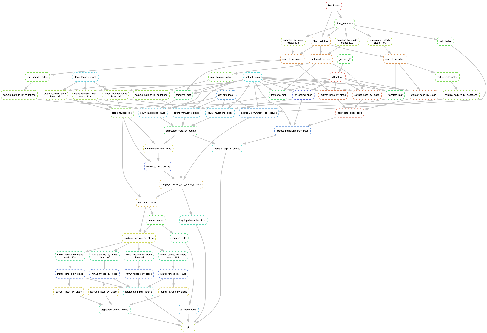

# mat-pcp: Unified MAT Analysis Pipeline

A Snakemake pipeline for analyzing SARS-CoV-2 genomic evolution from mutation-annotated trees (MATs). This pipeline extracts parent-child pairs (PCPs), counts mutations, estimates neutral mutation rates, and calculates fitness effects.

## Overview

This pipeline combines functionality from three previously separate projects:
1. **mat-pcp** - Parent-child pair extraction from MATs
2. **SARS2-mut-fitness** - Expected vs actual mutation count computation
3. **SARS2-mut-fitness-v2** - Neutral mutation rate estimation via GLM

## Pipeline DAG

The following diagram shows the workflow structure when running with test data (`max_clades=3`):



## Quick Start

### Prerequisites

- [pixi](https://pixi.sh/) for environment management
- Input MAT tree (`.pb` or `.pb.gz` format)
- Sample metadata (`.tsv` or `.tsv.gz` format)

### Installation

```bash
git clone <repository-url>
cd mat-pcp
pixi install
```

### Configuration

Edit `config/config.yaml` to specify your inputs:

```yaml
mat: "path/to/your/tree.pb.gz"
metadata: "path/to/your/metadata.tsv.gz"
output_dir: "results"
```

### Running the Pipeline

```bash
# Dry run to see what will be executed
pixi run snakemake -n

# Run with 4 cores
pixi run snakemake -j 4 --use-conda

# Run specific target
pixi run snakemake -j 4 --use-conda results/aamut_fitness/all_aamut_fitness.csv
```

## Pipeline Stages

| Stage | Description | Key Outputs |
|-------|-------------|-------------|
| 1. Input & Reference | Filter metadata, link inputs, fetch reference genome and annotations | `filtered_metadata.tsv.gz`, `ref.fa`, `coding_sites.csv` |
| 2. Clade Processing | Identify clades, extract clade subtrees and PCPs | `clade_counts.csv`, `clades/{clade}_tree.pb`, `all_pcps.csv` |
| 3a. Clade Founders | Download and process clade founder sequences | `clade_founders/{clade}.fa`, `clade_founder_nts.csv` |
| 3b. Mutation Counting | Translate mutations, count per-clade mutations | `mutations/{clade}_mutations.tsv`, `mutation_counts/aggregated.csv` |
| 4. Expected Counts | Compute synonymous rates and expected mutation counts | `synonymous_mut_rates/`, `expected_vs_actual_mut_counts.csv` |
| 5. GLM Annotation | Annotate counts with RNA structure and sequence context | `glm/annotated_counts.csv`, `glm/curated_counts.csv` |
| 6. Rate Estimation | Estimate neutral mutation rates via GLM | `glm/master_table.csv`, `rates_table.csv` |
| 7a. NT Fitness | Compute nucleotide-level fitness estimates | `fitness/ntmut_fitness_aggregated.csv` |
| 7b. AA Fitness | Compute amino acid-level fitness estimates | `aamut_fitness/all_aamut_fitness.csv` |
| 8. Validation | Cross-validate PCP vs matUtils mutation counts | `validation/pcp_vs_counts_report.txt` |

## Primary Outputs

| Output | Description |
|--------|-------------|
| `mat/all_pcps.csv` | All parent-child pairs with clade annotations |
| `mat/clade_counts.csv` | Sample counts per clade |
| `clade_founder_nts.csv` | Nucleotide at each coding site for all clade founders |
| `mutation_counts/aggregated.csv` | Aggregated mutation counts across all clades |
| `expected_vs_actual_mut_counts.csv` | Expected and actual mutation counts |
| `glm/annotated_counts.csv` | Mutation counts annotated with RNA structure and context |
| `glm/curated_counts.csv` | Curated counts for GLM training |
| `glm/master_table.csv` | Full GLM rate table with light-switch boundaries |
| `rates_table.csv` | Neutral mutation rates by context |
| `spike_codon_sites_to_mask.txt` | Problematic codon sites in target gene |
| `fitness/predicted_counts_by_clade.csv` | GLM-predicted counts per clade |
| `fitness/ntmut_fitness_aggregated.csv` | Nucleotide-level fitness estimates |
| `aamut_fitness/all_aamut_fitness.csv` | Amino acid-level fitness estimates |
| `validation/pcp_vs_counts_report.txt` | PCP vs counts validation report |

## Configuration Options

See `config/config.yaml` for all configuration options. Key parameters are organized into sections:

### Input/Output

| Parameter | Description | Default |
|-----------|-------------|---------|
| `output_dir` | Output directory | `results` |
| `mat` | Path to input MAT tree (.pb or .pb.gz) | - |
| `metadata` | Path to sample metadata (.tsv or .tsv.gz) | - |

### Reference Genome

| Parameter | Description | Default |
|-----------|-------------|---------|
| `ref_fasta` | URL or path to reference FASTA | UCSC wuhCor1 |
| `ref_gtf` | URL or path to reference GTF | UCSC ncbiGenes |
| `add_to_ref_gtf` | Manual GTF additions (e.g., ORF9b) | `{ORF9b: [28284, 28577]}` |

### QC Filtering

| Parameter | Description | Default |
|-----------|-------------|---------|
| `qc_filter_options.min_date` | Earliest sample date | `2019-12-01` |
| `qc_filter_options.datetime_cutoff` | Latest sample date | `2022-06-01` |
| `qc_filter_options.valid_hosts` | Allowed host species | `["Human", "Homo sapiens"]` |
| `qc_filter_options.min_genome_length` | Minimum genome length | `28000` |
| `subset_frac` | Random sampling fraction (1.0 = no sampling) | `1.0` |

### Clade Configuration

| Parameter | Description | Default |
|-----------|-------------|---------|
| `clade_column` | Metadata column for clades | `Nextstrain_clade` |
| `min_clade_size` | Minimum samples per clade | `2` |
| `clades_to_exclude` | List of clades to skip | `[]` |
| `max_clades` | Limit number of clades (for testing) | `null` |

### PCP Extraction

| Parameter | Description | Default |
|-----------|-------------|---------|
| `pcp_gene_region` | Genomic region for PCPs (null = full genome) | Spike (21563-25384) |
| `pcp_max_nt_mutations` | Max nucleotide mutations per branch | `4` |
| `pcp_max_reversions_to_ref` | Max reversions to reference | `1` |

### Mutation Counting

| Parameter | Description | Default |
|-----------|-------------|---------|
| `max_nt_mutations` | Maximum mutations per branch | `4` |
| `max_reversions_to_ref` | Max reversions to reference | `1` |
| `max_reversions_to_clade_founder` | Max reversions to clade founder | `1` |
| `exclude_ref_to_founder_muts` | Exclude ref→founder mutations | `true` |
| `site_include_range` | Genomic range for mutation counting | `{start: 266, end: 29674}` |
| `sites_to_exclude` | List of problematic sites | See config |

### GLM Rate Estimation

| Parameter | Description | Default |
|-----------|-------------|---------|
| `rna_structure_data` | Path to RNA structure data | `data/lan_2022/...` |
| `glm_lightswitch_boundaries` | Position-dependent rate boundaries | See config |

### Fitness Estimation

| Parameter | Description | Default |
|-----------|-------------|---------|
| `fitness_pseudocount` | Pseudocount for fitness calculation | `0.5` |
| `fitness_N_f` | Number of fitness grid points | `300` |
| `fitness_N_n_exp` | Number of expected counts grid points | `300` |

### Data Files

The pipeline uses reference data files in `data/`:
- `usher_masked_sites.yaml`: UShER masking information for problematic sites by clade
- `lan_2022/`: RNA secondary structure data from Lan et al. 2022

### Conda Environments

The pipeline uses three specialized conda environments in `workflow/envs/`:

| Environment | Purpose | Key Packages |
|-------------|---------|--------------|
| `default.yml` | Python data processing and analysis | pandas, numpy, biopython, scipy, statsmodels |
| `usher.yml` | MAT tree manipulation | matUtils (from UShER) |
| `bte.yml` | Efficient tree traversal for PCP extraction | BTE library |

## Output Structure

Results are organized in the output directory:

```
results/
├── mat/
│   ├── clades/                    # Per-clade subtrees and PCPs
│   │   ├── {clade}_tree.pb        # Clade-specific MAT subtree
│   │   ├── {clade}_pcps.csv       # Clade-specific parent-child pairs
│   │   └── {clade}_samples.txt    # Sample names in each clade
│   ├── mat_tree.pb.gz             # Symlink to input MAT
│   ├── metadata.tsv.gz            # Symlink to input metadata
│   ├── filtered_metadata.tsv.gz   # QC-filtered metadata
│   ├── filtered_tree_raw.pb       # Filtered MAT tree
│   ├── all_pcps.csv               # Aggregated PCPs across all clades
│   └── clade_counts.csv           # Sample counts per clade
├── ref/
│   ├── ref.fa                     # Reference genome (FASTA)
│   ├── original_ref.gtf           # Original GTF annotations
│   ├── edited_ref.gtf             # GTF with manual additions
│   ├── coding_sites.csv           # Coding site annotations
│   └── site_mask.csv              # Problematic sites from VCF
├── clade_founders/
│   ├── {clade}.fa                 # Founder sequence for each clade
│   ├── {clade}_ref_to_founder_muts.csv  # Mutations from ref to founder
│   ├── clade_founders_neher.json  # Neher lab clade founder data
│   └── clade_founders_roemer.json # Roemer clade founder data
├── mutations/
│   ├── {clade}_mutations.tsv      # Translated mutations (matUtils)
│   ├── {clade}_sample_paths.tsv   # Sample mutation paths
│   └── {clade}_nt_mutations.csv   # Nucleotide mutation counts
├── mutation_counts/
│   ├── {clade}.csv                # Per-clade mutation counts
│   └── aggregated.csv             # Aggregated counts across clades
├── synonymous_mut_rates/
│   └── rates_by_clade.csv         # Synonymous mutation rates per clade
├── expected_mut_counts/
│   └── expected_counts.csv        # Expected mutation counts
├── glm/
│   ├── annotated_counts.csv       # Counts with RNA structure context
│   ├── clade_founder_annotated.csv # Annotated clade founder data
│   ├── curated_counts.csv         # Curated counts for GLM
│   └── master_table.csv           # Full GLM rate predictions
├── fitness/
│   ├── predicted_counts_by_clade.csv    # GLM-predicted counts
│   ├── ntmut_counts/              # Per-clade nucleotide counts
│   ├── ntmut_fitness/             # Per-clade nucleotide fitness
│   └── ntmut_fitness_aggregated.csv     # Aggregated NT fitness
├── aamut_fitness/
│   ├── {clade}_aamut_fitness.csv  # Per-clade amino acid fitness
│   └── all_aamut_fitness.csv      # Aggregated AA fitness
├── validation/
│   ├── pcp_derived_counts.csv     # Mutation counts from PCPs
│   ├── pcp_vs_counts_report.txt   # Validation report
│   └── pcp_vs_counts_discrepancies.csv  # Any discrepancies found
├── benchmarks/                    # Snakemake benchmark files
└── log/                           # Processing logs per rule
```

## Testing

```bash
# Run pipeline on test data (uses subset_frac=0.1 for faster testing)
pixi run snakemake -j 4 --use-conda \
  --config output_dir="results_test_data" \
           mat="test_data/filtered_tree_raw.pb.gz" \
           metadata="test_data/filtered_metadata.tsv.gz" \
           subset_frac=0.1 \
           max_clades=3

# Validate results against expected
pixi run python workflow/scripts/validate_test.py
```

The validation checks:
- Total number of PCPs extracted
- Number of clades processed
- Total sequences across all clades
- Presence of expected output files
- PCP vs mutation count consistency

## CI/CD

The pipeline includes automated testing via GitHub Actions that runs on every push and pull request:
1. Validates configuration schema
2. Verifies required data files
3. Runs the full pipeline on test data
4. Validates outputs against expected results
5. Checks PCP vs mutation count validation

## License

See LICENSE file for details.
